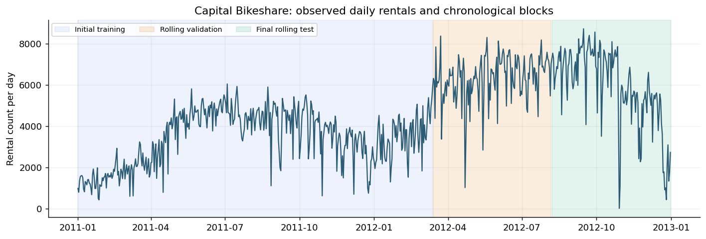
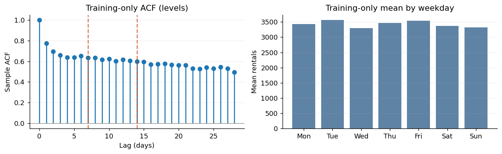
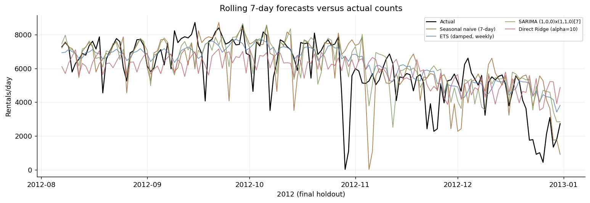
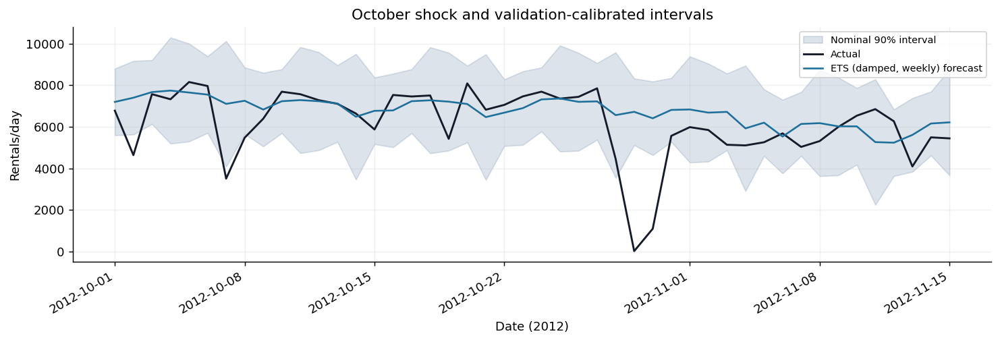

# **Math 546 Capstone Stage 1:** Bikeshare Forecasting Report

  
**Jai Kasera**

## Data and forecasting task

I use the bike dataset (`load_dataset("bike")`) to predict the number of rentals on each of the next seven days. The dataset has 731 daily observations from January 2011 through December 2012, with no missing rental counts. These forecasts could help a bike-share operator plan staffing and bike rebalancing for the coming week.

A forecast is made after the current day has ended, so the model can use past rental counts and future calendar information (day of week, holidays, and working days). It cannot** use actual future temperature, humidity, wind, or weather conditions. I also exclude `casual` and `registered`, which are components of the target `cnt`.

I split the series chronologically, without shuffling:

| Period     | Dates                        | Observations |
| ---------- | ---------------------------- | ------------ |
| Training   | Jan. 1, 2011 – Mar. 13, 2012 | 438          |
| Validation | Mar. 14 – Aug. 6, 2012       | 146          |
| Test       | Aug. 7 – Dec. 31, 2012       | 147          |

## 2. Diagnostics and models

Daily rentals show a changing level and strong weekly patterns. On the initial training data, autocorrelation is 0.634 at lag 7 and 0.597 at lag 14. This suggests that the previous week's rentals should be a useful baseline. Stationarity tests also motivate seasonal differencing: for the rental-count levels, the ADF test has $p=0.3124$ and KPSS has $p\leq0.01$; after differencing at lag 7, ADF has $p\approx3.1\times10^{-8}$ and KPSS has $p\geq0.10$. These tests support a weekly-differenced model but do not prove stationarity.

I compare four forecasting approaches:

1. **Seasonal naive:** Predict each day using the rental count from the same weekday one week earlier, $\hat y_{t+h\mid t}=y_{t+h-7}$. This is the baseline.
2. **ETS / Holt–Winters:** Exponential smoothing with an additive trend, damped trend, and additive seven-day seasonality. It captures the weekly cycle while limiting long-run trend extrapolation.
3. **SARIMA:** $\operatorname{SARIMA}(1,0,0)\times(1,1,0)_7$ with an intercept. Weekly differencing addresses the apparent nonstationarity, and autoregressive terms capture serial dependence.
4. **Direct Ridge regression:** Seven regressions, one per forecast horizon, using observed rental lags, recent moving averages, and known calendar features. I compare penalties $\alpha\in1,10,100$ using validation data and select $\alpha=10$.

The models use only information available at each forecast origin. I did not train neural networks or transformers given the small dataset and the course's emphasis on classical forecasting methods.

## 3. Backtesting and results

I use expanding-window backtesting rather than a random train/test split. Every seven days, each model is refitted on data observed up to that date and forecasts the following seven days. This produces 20 validation forecast origins (140 scored days) and 21 test origins (147 scored days). Forecast targets never overlap within an evaluation period. The remaining six validation days are not scored but become past information by the first test origin.

I select the model with the lowest validation MAE, then evaluate its frozen specification on the test period. MAE is the average absolute error in rentals per day, RMSE penalizes large errors more heavily, and WAPE expresses aggregate absolute error relative to total observed demand.

| Model                    | Validation MAE | Test MAE  | Test RMSE   | Test WAPE |
| ------------------------ | -------------- | --------- | ----------- | --------- |
| Seasonal naive           | 1,154.2        | 1,194.7   | 1,759.7     | 20.3%     |
| **ETS (damped, weekly)** | **921.1**      | **902.8** | **1,349.6** | **15.3%** |
| SARIMA                   | 996.4          | 1,010.5   | 1,505.2     | 17.1%     |
| Ridge ($\alpha=10$)      | 956.5          | 1,200.7   | 1,533.8     | 20.4%     |

ETS was selected on validation and also performed best on the test set. Its test MAE of 902.8 is 24.4% lower than the seasonal-naive benchmark. SARIMA also beats the baseline, but Ridge does not: its validation performance was promising, yet its test MAE increased to 1,200.7. This is a reminder that adding features does not guarantee better out-of-sample forecasts. The ETS model overpredicted by 225.2 rentals per day on average in the test period.

## 4. Uncertainty and forecast errors

For the selected ETS model, I construct nominal 90% prediction intervals using the distribution of absolute errors from validation. I calculate a separate error cutoff for each forecast horizon, then add and subtract it from the forecast, truncating the lower limit at zero. The cutoff is the 19th smallest absolute error from the 20 validation origins at each horizon. Test observations are not used to set interval widths.

The intervals cover 91.2% of test rental counts and have an average width of 4,174.5 rentals. Although the observed coverage is near 90%, these intervals are quite wide, and 20 calibration examples per horizon are not enough to guarantee reliable coverage in every season or demand regime.

ETS errors vary across groups. Its test MAE is 802.3 on weekdays versus 1,154.0 on weekends, and 1,826.8 on holidays (only five holiday observations). Error also increases with forecast horizon: 764.9 for days 1–3 versus 1,006.2 for days 4–7.

The largest error occurred on October 29, 2012: the actual count was 22, while ETS predicted **6,793.4**. The model captures typical weekly demand but cannot anticipate sudden disruptions from the past rental series alone. Since the dataset does not identify the cause of that drop, I cannot attribute it definitively to a particular event.

## 5. Model risks and conclusion

| Risk                                    | How I addressed it / next step                                                                                                                |
| --------------------------------------- | --------------------------------------------------------------------------------------------------------------------------------------------- |
| **Look-ahead leakage**                  | Use only past observed rentals and known calendar features. Do not use future measured weather or target components.                          |
| **Overfitting and test contamination**  | Select models and Ridge penalty on validation; keep the test period for final evaluation. Refit only on information available at each origin. |
| **Demand shocks and changing patterns** | Compare ongoing errors with seasonal naive, and review performance after unusual low-demand days or sustained degradation.                    |
| **Uncertain interval calibration**      | Intervals use only 20 validation errors per horizon. Monitor empirical coverage and recalibrate with more observations.                       |
| **Limited historical data**             | The sample spans only two years; results may not hold for other cities or more recent bike-sharing behavior.                                  |

I recommend the weekly seasonal ETS model with a damped trend for this dataset. It is relatively simple, is supported by the observed weekly pattern, and has the lowest validation and test errors. I would retain seasonal naive as a benchmark and monitor whether ETS continues to outperform it. The main remaining limitation is unusual demand shocks, for which historical rental counts alone provide little warning.